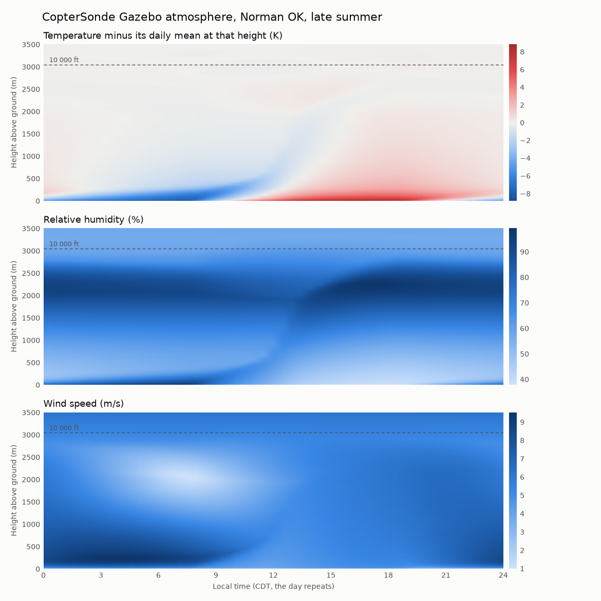
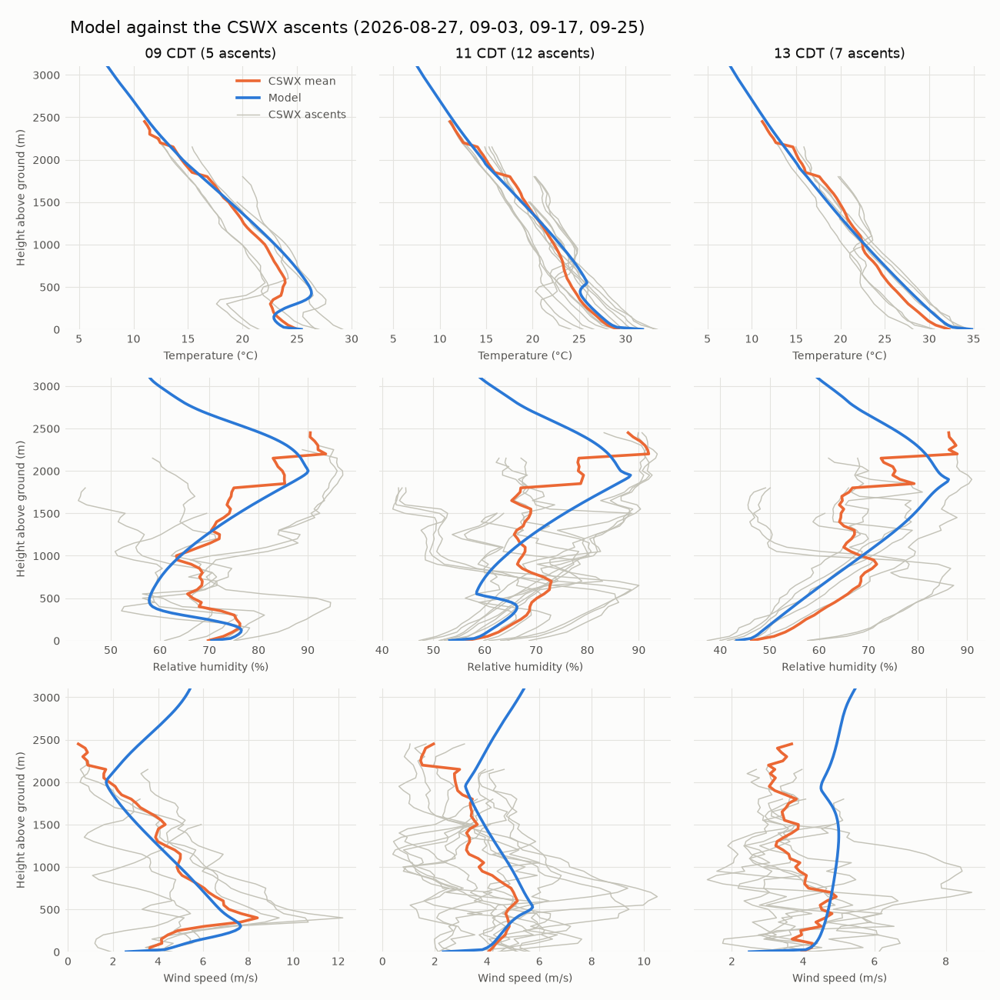

# CopterSonde Gazebo simulator

The CopterSonde flies over the Norman, OK radar-site world through air with a realistic, repeating daily cycle of the planetary boundary layer (PBL): temperature, relative humidity, wind and turbulence from the ground to 3500 m (11 500 ft). The firmware reads that air through its own sensor drivers:

- **iMet bead thermistors (AC_CASS_IMET):** SITL simulates the ADS1115 and the bead circuit.
- **HYT271 hygrometers (AC_CASS_HYT271):** SITL simulates the sensor itself.
- **Wind:** the wind-vane estimator measures the real tilt that the wind forces on the vehicle.

The IMET, RHUM and WIND logs, CASS_SENSOR_RAW and LAAIRS all work as on the real CopterSonde.

| Part | Where |
|---|---|
| World, vehicle model, atmosphere table, SITL parameters, tools | this folder (my-ardupilot `ArduPilot-4.6-CS-gazebo`) |
| SITL sensor simulators, JSON `atmosphere` fields | `libraries/SITL/SIM_CASS.*`, `SIM_JSON.*` |
| `CopterSondePlugin` (air, wind force, battery), `ArduPilotPlugin` `<json_extra_topic>` | ardupilot_gazebo `main-CopterSonde` |
| Skycharge digital twin, BOLOGNINI S1 pad and launch deck | `skycharge/`, `models/cs_*pad*`, `models/cs_skycharge_bolognini` (see [Skycharge charging pad](#skycharge-charging-pad)) |

## Run

Build once:

```bash
# from the ArduPilot checkout, with ardupilot_gazebo cloned next to it (or ARDUPILOT_GAZEBO set)
(cd "${ARDUPILOT_GAZEBO:-../ardupilot_gazebo}" && git checkout main-CopterSonde && mkdir -p build && cd build && GZ_VERSION=jetty cmake .. && make -j8)
```

```bash
./waf configure --board sitl && ./waf copter
```

Then start the two sides, also from the ArduPilot checkout:

```bash
# Terminal A: Gazebo (generates the Norman world the first time)
CopterSonde-sim/tools/coptersonde_gazebo.sh

# Terminal B: SITL
CopterSonde-sim/tools/coptersonde_sitl.sh
```

Connect LAAIRS with **WSL SITL** (TCP 127.0.0.1:5760); SITL waits for that connection before it starts. TCP 5762 is free for MAVProxy (`mavproxy.py --master tcp:127.0.0.1:5762 --console`) or the flight-test script.

Fly a profile as in the field: on the ground flip RC7 (AutoVP, `RC7_OPTION 47`), arm in Loiter and switch to Auto. The script does the same:

```bash
python3 CopterSonde-sim/tools/vp_flight_test.py --alt 2438
```

As on the real CS3D, the VP battery monitor (`USR_VPBATT_WH 190`, 25 % reserve) ends the climb with an RTL at about 2.7 km. To profile up to 10 000 ft, let it only warn: `--alt 3048 --param USR_VPBATT_EN=0`.

Use the scripts rather than a bare `sim_vehicle.py`. The `sim_vehicle.py` on PATH may belong to another ArduPilot tree (RFSonde), and it runs the firmware of the tree it lives in.

### Options

`coptersonde_gazebo.sh` options:

| Option | Effect |
|---|---|
| `--start-hour H` | local time of day when the simulation starts (default 9, the CSWX flight window) |
| `--cycle-hours H` | simulation hours for one day of the atmosphere: 24 is real time, 2 runs the day 12 times faster |
| `--truth-log FILE` | writes the air, wind and battery at the vehicle at 10 Hz (CSV), for `profile_eval.py` |
| `--headless` | Gazebo server only |
| `--instance N` | talk to SITL instance N; start SITL with `coptersonde_sitl.sh -I N` |

`-I 0`, the default, makes `sim_vehicle.py` stop every other running arducopter. Use another instance to keep one running.

## Atmosphere

`atmosphere/norman_pbl.csv` holds one day: every 30 min, every 25 m from 0 to 3500 m. It covers temperature, relative humidity, pressure, wind (east, north) and turbulence standard deviations. The plugin interpolates it in time (wrapping at midnight) and height. `tools/pbl_model.py` generates it.

The model is a 1D column model of potential temperature, humidity and wind:
- Surface fluxes follow the sun; at night a bulk flux carries the air towards the cooling ground.
- Mixing is a non-local K-profile in the convective boundary layer and Richardson-number mixing at night.
- The geostrophic wind veers with height, and the Coriolis force acts on the wind.
- Radiative cooling and relaxation to a reference sounding close the daily budget.

It runs the same day until it repeats, and writes the last one.



The forcing was fitted to the 32 CSWX ascents flown on 2026-08-27, 09-03, 09-17 and 09-25 (09:00–13:00 CDT, up to 2438 m), plus the season's dawn minimum and afternoon maximum. The resulting day:

| Time | What happens |
|---|---|
| Night | a surface inversion forms (19 °C at the ground, 26 °C at 300 m before dawn) with dew near the ground, and a south-southwesterly low-level jet of about 9 m/s at 300 m (an inertial oscillation) |
| 09–13 | a mixed layer grows into the night's inversion and residual layer; humidity increases with height to a maximum near its top, as in the CSWX profiles |
| Afternoon | a dry-adiabatic mixed layer 2.4 km deep at 35–36 °C at the ground, with convective turbulence (σu ≈ 1.5 m/s) |
| Above | the free troposphere: 3.4 K/km potential-temperature lapse rate and drier air |

Against the CSWX composite at 09–13 CDT, temperature is mostly within 1–2 K, humidity within 5–10 % and wind within 1–2 m/s. Individual days differed more than this from one another.



`tools/plot_atmosphere.py --cswx "<folder of CopterSonde logs>"` redraws both figures. To change the climate, edit `Forcing` in `tools/pbl_model.py` and rerun it (about 30 s):

```bash
python3 CopterSonde-sim/tools/pbl_model.py
```

To use another table, set `CS_ATMOSPHERE=/path/table.csv` before starting Gazebo, or change `<profile>` in `models/coptersonde/model.sdf`. Any table with the same columns works, including one built from real soundings.

Gusts are two Gauss-Markov processes per axis (large and small eddies) with the table's standard deviations. Their time scales are the integral length scale over the mean wind.

## Vehicle

`models/coptersonde` is the ArduPilot Iris airframe (`iris_with_ardupilot`, 1.75 kg, `FRAME_TYPE 1`) with a sensor scoop drawn at the nose. Its `CopterSondePlugin` does four things.

- **Propellers.** It replaces the Iris's LiftDrag blades. Thrust is k·ω² along the spin axis, reduced when air flows down through the disk (a climb) and in thin air; a drag torque of 0.016 m × thrust acts against the spin. Hover is at 450 rad/s, and the thrust-to-weight ratio is 3.5. The LiftDrag blades see only the vehicle's own motion, not the rotor's induced flow. In a 5 m/s descent they windmill, the air drives the rotors and the yaw control reverses: the Iris spins up in yaw and tumbles about 30 s into a long descent.

- **Air at the vehicle.** It looks up the table at the vehicle's height and the time of day, adds gusts, and sends the result to SITL in the JSON `atmosphere` section (temperature, humidity, pressure), with the wind in `velocity_wind`.
- **Wind force.** Air moving past the vehicle pushes it with the force that tilts the real CopterSonde. The wind-vane calibration gives the airspeed v at a tilt ratio r = tan(tilt) as v = a·r + b·√r (`USR_WV_WSA` 39.3, `USR_WV_WSB` 2.1 on the CS3D, log 00000080). So the horizontal force is m·g·r(v), scaled by the air density over the calibration density (1.13 kg/m³). Like the real vehicle, the estimator therefore reads a little low in the thin air aloft. Vertical motion has a plain quadratic drag.
- **Battery.** A 6S 9 Ah LiPo, sent in the JSON `battery` section. The current follows the rotor power from momentum theory: the induced power T·(Vc/2 + √((Vc/2)² + vi²)) grows with the thrust, the climb rate through the air and thinner air, and a 30 % profile power follows the rotor speed up to its hover value. The hover current (20 A) and the induced velocity (8 m/s) are fitted to the CSWX flights: the simulator draws 21.5 A in hover, 28.1 A climbing and 15.7 A descending at 5 m/s (real: 20–21, 24–28 and 15–18 A). The VP battery monitor and the current failsafes see the same numbers as on the real vehicle.

`gz topic -e -t /model/coptersonde/coptersonde` shows what goes to SITL every 10 ms, including the local hour and the wind speed and direction at the vehicle.

## Sensors in SITL

SITL simulates the sensors on I2C bus 0, where the drivers look for them. As on the CS3D on the CSWX flights, there are three of each (`USR_SENSOR4` and `USR_SENSOR8` are 0):

| Sensor | Addresses | Behaviour |
|---|---|---|
| iMet bead + ADS1115 | 0x48–0x4A | 1.5 s lag; bead resistance from the inverse Steinhart–Hart of the loaded `USR_SEN_A/B/C` coefficients, through the 64.9 kΩ divider and 16-bit ADC with noise; fixed biases of +0.08, −0.05 and +0.03 K |
| HYT271 | 0x10–0x12 | 5 s humidity lag; 14-bit humidity and temperature with the stale bit; the sensor runs 1.2 K warmer than the air near the ground, more as the air thins (as in the logs); the raw humidity inverts the loaded `USR_RH_A/B/C` correction, so the corrected humidity matches the air; biases of +0.6, −0.4 and +0.2 % |

The lags and the self-heating were measured on the CSWX flights, from the ascent–descent difference and HYT271 minus iMet temperature. Without Gazebo (plain `sim_vehicle.py -f quad`), the simulators use the altitude profile the SITL code used to fake.

`config/coptersonde.parm` loads the CS3D's sensor IDs and calibrations, wind vane, VP battery, AutoVP, battery, fence and navigation settings. It does not load the attitude tuning, notch filter or motor outputs, which belong to a different airframe.

It does tune the simulated airframe's roll: the Gazebo Iris's roll inertia is half its pitch inertia. With SITL's default rate gains, roll oscillates at about 2 Hz (rate spread 10–17 °/s in hover and descent); the stock Iris in `iris_runway.sdf` does the same. `ATC_RAT_RLL_P/I/D` 0.07/0.07/0.0018 (half the defaults) bring it to 0.5 °/s.

## Verification

A 10 000 ft AutoVP profile at 09:00 (`--alt 3048 --param USR_VPBATT_EN=0`, 5 m/s up and down) compared with `profile_eval.py` in 250 m bins, as sensor minus truth, mean / RMS:

| | Ascent | Descent |
|---|---|---|
| iMet temperature | +0.07 / 0.08 K | −0.02 / 0.04 K |
| HYT271 humidity (corrected) | +0.3 / 0.8 % | +0.1 / 0.7 % |
| Wind-vane speed | −0.7 / 0.8 m/s | −0.4 / 0.5 m/s |
| Wind-vane direction | −0.4 / 0.9° | +0.4 / 0.9° |

The sensors lag as the real ones do: warm and dry going up through air that cools and moistens with height. The wind-vane speed reads low by up to 23 % at 3 km, where the air is about 25 % thinner, so the same wind tilts the vehicle less. The real estimator has no density correction either. Attitude stays steady through the whole profile, at 0.3–0.4 °/s rate spread on roll and pitch. With `USR_VPBATT_EN 1` the VP battery monitor sends the vehicle home at about 2.7 km.

## Skycharge charging pad

The CopterSonde starts on the launch deck at the take-off point, resting on a Skycharge BOLOGNINI S1 charging pad. As in the field, the pad charges it after landing, and LAAIRS runs the charging. The pad has three parts in the simulator:

| Part | What it is | Where |
|---|---|---|
| Pad and deck | The 1.5 m deck (`cs_launch_pad`), the S1 with its 6 × 6 steel tiles and the charge source box (`cs_skycharge_bolognini`). The geometry is estimated from Skycharge's photos and specifications. | `models/`, from `tools/make_pad_models.py` |
| Contact unit and battery | `CopterSondePlugin` `<skycharge>`. It checks whether the contact block under the body touches the tiles. When it does and the PSU is on, it charges the battery. | ardupilot_gazebo `main-CopterSonde` |
| Charge source (digital twin) | The pad's electronics and software: the MUX HW2 state machine, meters and parameters, `skycharged`, `skycharge-cli` over SSH, and the JSON API. | `skycharge/skycharge_twin` |

### The twin is a black box with the pad's interfaces

It reproduces what the open Skycharge SDK ([libskycharge](https://github.com/Skycharge/libskycharge) v2.2.2, `skyclient.c`) and [support.skycharge.de](https://support.skycharge.de/docs/tool) document:

- **SSH:** like the pad's BeagleBone, it takes `root` with the vendor key only (password login is off). It also takes only SHA-1 `ssh-rsa` signatures, which is why LAAIRS pins paramiko below 5.
- **`skycharge-cli`:** every command, with the same text in plain, `--no-pretty` and `--json` output, and the same exit status (255 for errors).
  - It rejects bad input the same way. For example, `batt-type` knows only `Li-Po` and `Li-Ion`.
  - Commands do nothing in the wrong state: `sink-start-charge` acts only in `CHARGING_FINISHED`, `sink-stop-charge` only while charging, `resume-scan` only when stopped.
- **States:** `SCANNING` → `LINK_ESTABLISHED` → `PRECHARGE_DELAYED` → `PRECHARGING` (ramp) → `CHARGING` → `CHARGING_FINISHED` with its reason.
  - Losing the drone gives `ERR_BAD_LINK` (the normal end of a session), then scanning again after `error-indication-timeout-secs`.
  - A finished charge restarts after `repeat-charge-after-mins`.
- **`skycharge.conf`:** runtime parameter changes are lost on a power cycle, because `skycharged` reloads `skycharge.conf` when it starts.
- **JSON API:** the cloud `/v1/...` requests (`charging-state`, `sink-charging-params`, `scan-stop`, ...), with `user-uuid`/`device-uuid` checks.
- **Twin-only control (`skytwin`, over the same SSH):**
  - Bench mode: place or remove the drone, and set the battery.
  - Faults: `short-circuit`, `low-mux-voltage`, `voltage-on-output`, `mux-overtemp`, `contact-bounce`.
  - `power-cycle`: the pad stops answering for 45 s, then comes back with its `skycharge.conf` values.

### Electrical model

The PSU holds the charge voltage V (`batt-max-voltage-mv`) and limits the current to I_lim (the precharge ramp, then `charging-max-current-ma`). The pack has open-circuit voltage OCV and resistance R. The tiles, contacts and sink add R_path. The drone draws I_load on the pad. The current is then

    I = clamp((V - OCV + R·I_load) / (R_path + R), 0, I_lim)

The charge current goes into the cells but not through the power module. So SITL, and LAAIRS through MAVLink, see the pack voltage rise while the current stays at I_load, as on the real CopterSonde. The pad meters the total current, so it can only reach its cutoff (`cutoff-min-current-ma`) if the drone draws less than that while disarmed.

`idle_current` is 0.2 A. The CSWX logs show 0.11–0.21 A after disarm (`BAT.Curr`). At the earlier 0.8 A, above the 500 mA cutoff, the pad would never report full and would stop only at its time limit. `hover_current` went from 20 to 20.6 A, so the flight currents stay as fitted (21.5 A hover, 28.3 A climb, 15.6 A descent at 5 m/s).

### Run

```bash
# Gazebo and SITL as usual, then the twin in a third terminal:
~/Github/my-ardupilot-CS/CopterSonde-sim/tools/skycharge_twin.sh --gazebo
```

In LAAIRS, choose **Digital twin (simulator)** in the Skycharge console (View → Toggle Skycharge Console). The console connects to `127.0.0.1:2222`, which WSL forwards from Windows. Alternatively, tick "Use Skycharge charging pad" in the site-arrival checklist. Then:

- **Charging:** the drone charges on the pad while disarmed, and arming is blocked until the battery is full or the operator skips.
- **Take-off:** arming suspends the pad.
- **Landing:** the pad charges again once the post-flight checklist is acknowledged.

By hand:

```bash
ssh -i id_rsa.skydevice -p 2222 -o PubkeyAcceptedAlgorithms=+ssh-rsa root@127.0.0.1 skycharge-cli monitor --pretty
```

Without `--gazebo`, a battery inside the twin is the plant (bench mode): `skytwin place`, `skytwin battery 0.3`.

Two environment variables for `coptersonde_gazebo.sh` set the pack for charging tests:

- `CS_BATTERY_SOC=0.5` starts at half charge.
- `CS_BATTERY_AH=1` uses a 1 Ah pack. A 9 Ah pack takes about 45 min of constant-voltage taper to reach the 500 mA cutoff.

Gazebo topics are shared between Gazebo instances. Give a second simulator its own `GZ_PARTITION`, and run the twin in the same one.

### Tests

```bash
python3 -m pytest CopterSonde-sim/tests/test_skycharge_twin.py
```

These cover:

- the CLI against the SDK's formats and errors;
- the state machine and its timers on a simulated clock;
- the electrical model;
- SSH, including that SHA-2-only clients (paramiko 5) are refused;
- `monitor` streaming;
- the JSON API;
- the power cycle.

`tools/skycharge_e2e.py` runs the whole chain: SITL + Gazebo + the twin + LAAIRS's own Skycharge manager, which it imports from a BLISS-GCS checkout and runs with LAAIRS's Python. Its four phases:

1. On the pad at start-up: the pad charges and LAAIRS blocks arming.
2. The operator skips the charge: the pad ends with `CHARGING_FORCIBLY_STOPPED`, and LAAIRS must not call that full.
3. Take-off, hover and RTL back onto the pad.
4. After the post-flight checklist, a charge to the current cutoff.

## Compare a flight with the truth

```bash
coptersonde_gazebo.sh --truth-log /tmp/truth.csv     # Terminal A
coptersonde_sitl.sh                                  # Terminal B, then fly
python3 CopterSonde-sim/tools/profile_eval.py logs/00000001.BIN /tmp/truth.csv
```

It splits the flight into ascent and descent and compares the logged iMet temperature, corrected humidity and wind-vane speed and direction with the truth in 50 m bins.

## Tests

```bash
python3 -m pytest CopterSonde-sim/tests
```

These check the table (grid, physical ranges, the midnight wrap, the diurnal cycle, the nocturnal inversion and jet, the afternoon mixed layer) and that the model's cycle repeats.

## World

The Norman, OK radar-site world is the RFSonde one: 2 km around KCRI at Max Westheimer Airport, with OpenStreetMap buildings, roads and trees and the radars at their true positions.

- **Origin:** the takeoff point at 35.2380802 N, 97.4631246 W, 358.6 m MSL (location `CopterSonde_Norman` in `Tools/autotest/locations.txt`).
- **Heading:** the vehicle starts facing south, into the prevailing wind.
- **Generation:** `tools/make_norman_world.py` writes the world and its `cs_norman_*` models; they are git-ignored. The `cs_` prefix keeps the RFSonde-sim models on the resource path from replacing them.

The OpenStreetMap data in `osm/norman_osm.json` is © OpenStreetMap contributors, ODbL.
